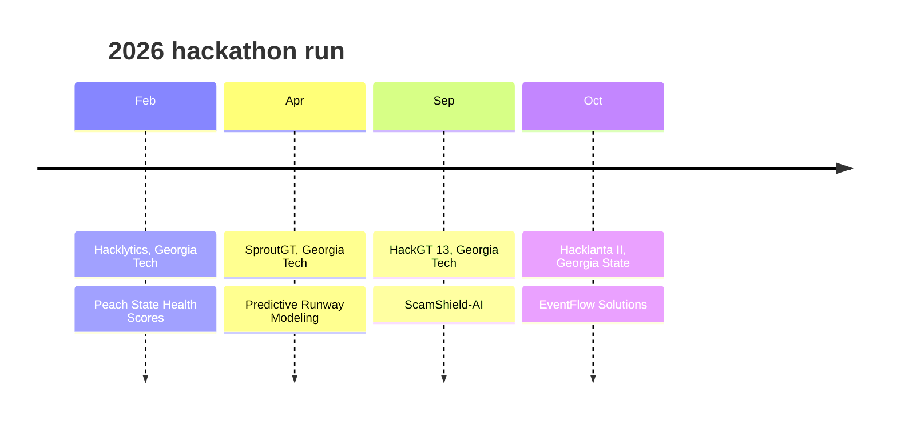
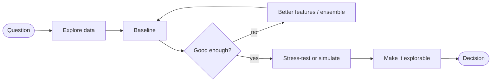
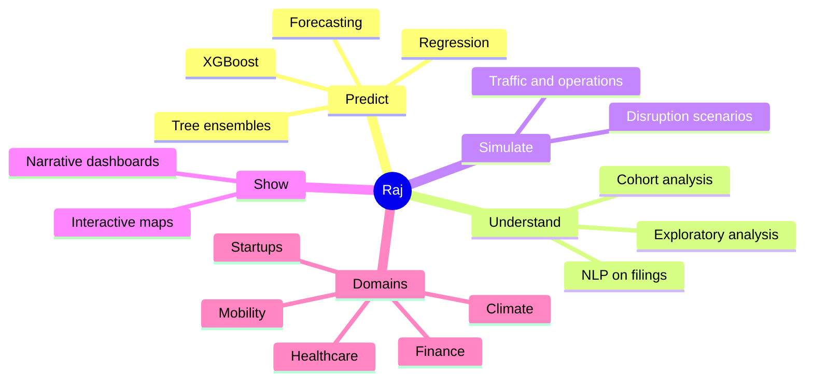

# Raj Kumar Parihar | Data Analyst • Accounting Professional • Research Aspirant • Lifelong Learner

<!-- Profile README for Raj Kumar Parihar. Place at the root of the public repo github.com/rajkumarparihar/rajkumarparihar -->

<div align="center">

<a href="https://github.com/rajkumarparihar">
  
</a>

**Georgia Tech master's student · Google-certified data analyst · hackathon builder**

[](https://www.linkedin.com/in/raj-kumar-parihar/)
[](https://github.com/rajkumarparihar)
[](https://www.linkedin.com/in/raj-kumar-parihar/)


<br/>

<table>
  <tr>
    <td align="center" width="25%"><h2>93.40%</h2><sub>lower forecasting error (MAPE)<br/>on U.S. Ex-Im Bank exposure</sub></td>
    <td align="center" width="25%"><h2>15 years</h2><sub>of S&amp;P 500 filings linked<br/>to market volatility</sub></td>
    <td align="center" width="25%"><h2>4</h2><sub>hackathon projects in 2026<br/>across Georgia Tech and Georgia State</sub></td>
    <td align="center" width="25%"><h2>1</h2><sub>Google Advanced Data Analytics<br/>Professional Certificate</sub></td>
  </tr>
</table>

</div>

<br/>

## About me

I'm a data person who likes questions with real stakes. How much financial exposure is coming? How do you keep a traffic corridor moving without paving more road? What does a company's tone say about market risk? My usual path is to start from the question, build the simplest model that could answer it, and then make the result explorable enough that other people trust it.

```yaml
name: Raj Kumar Parihar
based_in: Atlanta, Georgia, USA
education: Master's, Georgia Tech
certified: Google Advanced Data Analytics Professional Certificate
community: Mentor Me Collective
writing: "AI, BI, CI and DI: the many faces of intelligence"
looking_for:
  - problems where a forecast, a simulation or a visualization changes a decision
  - teammates who like to ship
```

---

## Featured work

<table>
<tr>
<td width="50%" valign="top">

### Forecasting financial exposure
`Python` `XGBoost` `ML pipeline`

Built an automated ML pipeline to forecast the **Export-Import Bank of the United States'** financial exposure.

I started with a linear baseline, then moved to an **XGBoost ensemble**. The result was a **93.40% reduction in forecasting error (MAPE)**.

<sub>Jan to Mar 2026</sub>

</td>
<td width="50%" valign="top">

### Market Mood and Volatility
`NLP` `Visual analytics` `Storytelling`

An interactive narrative analytics system for **S&amp;P 500 firms, 2009 to 2024**. It links 15 years of MD&amp;A filings to market volatility, so you can see corporate tone and market behavior move together through bull markets, corrections and crises.

<sub>Jan to Apr 2026</sub>

</td>
</tr>
<tr>
<td width="50%" valign="top">

### Traffic corridor simulation
`Simulation` `Operations research`

Tests whether **signal timing and phasing strategies** can improve suburban arterial corridors in Georgia, under higher demand and unexpected disruptions, before expensive lane expansion is considered.

<sub>May to Jul 2026</sub>

</td>
<td width="50%" valign="top">

### Project YR-Blue: marine carbon
`Python pipelines` `Climate analytics`

A Georgia Tech climate-data project working with an organization. Python data pipelines support scalable work that **reduces greenhouse gas emissions** and delivers measurable operational improvements.

<sub>Apr to Aug 2026</sub>

</td>
</tr>
<tr>
<td width="50%" valign="top">

### Multi-model cancer subtyping
`Machine learning` `Healthcare`

A team project that combines multiple models for cancer subtype classification.

<sub>Jul to Aug 2026</sub>

</td>
<td width="50%" valign="top">

### Personalized financial insights and spend analytics
`Analytics` `Personal finance`

Turns raw transaction data into personalized insights and spending analytics.

<sub>May to Jul 2026</sub>

</td>
</tr>
</table>

---

## Hackathon log



<details open>
<summary><b>What I built at each one</b></summary>
<br/>

| Event | Project | In one line |
|---|---|---|
| Hacklytics 2026 | **Peach State Health Scores** | An interactive map that makes Georgia restaurant health inspection scores searchable and visually explorable. |
| SproutGT 2026 | **Predictive Runway Modeling via Peer Cohort Analysis** | Forecasting for startups that replaces random predictions with peer-based cohort analysis. |
| HackGT 13 | **ScamShield-AI** | A coach for scam calls. It tells you what to say, what to do, and when to hang up. |
| Hacklanta II 2026 | **EventFlow Solutions** | A hackathon project built at Georgia State University. |

</details>

---

## How I approach a problem



The Ex-Im Bank project is the clearest example. The linear baseline wasn't good enough, so I iterated to an XGBoost ensemble.

---

## Skills map



<div align="center">


</div>

---

## Credentials and writing

| | |
|---|---|
| **Education** | Master's studies at Georgia Tech |
| **Certificate** | Google Advanced Data Analytics Professional Certificate (2026) |
| **Community** | Mentor Me Collective |
| **Article** | [The Many Faces of Intelligence: Decoding AI, BI, CI, and DI Across Contexts](https://www.linkedin.com/pulse/many-faces-intelligence-decoding-ai-bi-ci-di-across-contexts-parihar-3on7e) |

---

## GitHub activity

<div align="center">


</div>

---

<div align="center">

### Let's build something useful

[](https://www.linkedin.com/in/raj-kumar-parihar/)
[](https://github.com/rajkumarparihar)

<sub>Forecasts, simulations, filings, maps and scam calls. If it has data and a decision attached, I'm interested.</sub>

</div>
